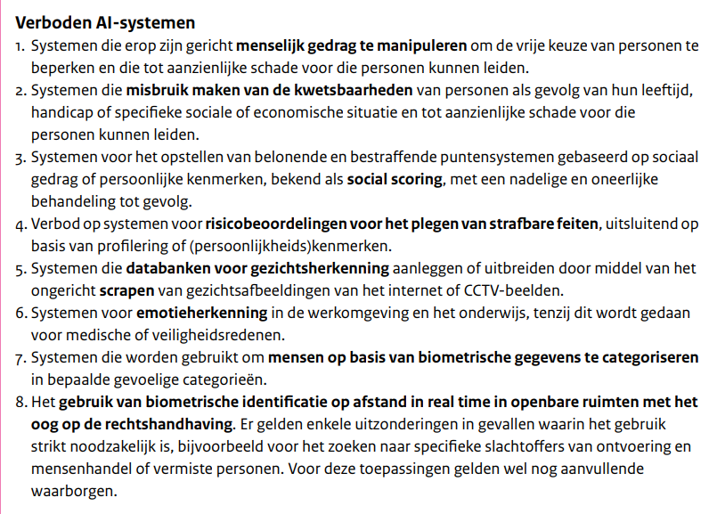

Per [2 februari 2025](https://www.autoriteitpersoonsgegevens.nl/themas/algoritmes-ai/ai-verordening) is de eerste set regels vanuit de Europese AI-verordening (de "AI-Act") van kracht geworden. Daarna volgen de andere onderdelen stap voor stap.

::: {.callout-important}
## Nieuwe tijdlijn door de Digital Omnibus (2026)
Met de *Digital Omnibus* (Verordening (EU) 2026/1744, in werking sinds 27 juli 2026) zijn een aantal data verschoven. Voor het onderwijs zijn dit de belangrijkste:

| Wanneer | Wat |
|---|---|
| 2 februari 2025 | Verboden AI-systemen (o.a. emotieherkenning in het onderwijs) en de verplichting rond AI-geletterdheid (artikel 4) |
| 2 augustus 2025 | Regels voor aanbieders van AI-modellen voor algemene doeleinden (zoals de modellen achter chatbots) |
| 2 augustus 2026 | Transparantieverplichtingen (artikel 50): je moet weten dat je met AI praat, AI-gegenereerde content moet herkenbaar zijn |
| 2 december 2026 | Nieuwe verboden op o.a. AI-toepassingen die naaktbeelden van echte personen genereren |
| **2 december 2027** | Verplichtingen voor **hoog-risico AI in het onderwijs** (Bijlage III), bijvoorbeeld AI die toelating bepaalt, leerresultaten beoordeelt of toetsgedrag monitort. Dit was eerst 2 augustus 2026. |
| 2 augustus 2028 | Hoog-risico AI in producten die al onder andere EU-regels vallen (Bijlage I) |

De tekst van artikel 4 over AI-geletterdheid is met de Omnibus herschreven. Organisaties die AI inzetten moeten nog steeds maatregelen nemen om de AI-geletterdheid van hun medewerkers te bevorderen. Controleer bij twijfel de [actuele tekst op EUR-Lex](https://eur-lex.europa.eu/eli/reg/2024/1689/oj).
:::

Sinds februari 2025 is een aantal AI-systemen **verboden**. Ook moeten organisaties die AI gebruiken werk maken van de **AI-geletterdheid** van hun medewerkers.

### Verboden AI-systemen
Onderstaande afbeelding geeft een overzicht van de categorieën die onder de verboden vallen:

{.img-fluid .rounded}

Meer informatie is te vinden bij:

- [Rijksoverheid: Gids AI-verordening](https://www.rijksoverheid.nl/documenten/brochures/2024/10/16/gids-ai-verordening)
- [Autoriteit Persoonsgegevens: AI-verordening](https://www.autoriteitspersoonsgegevens.nl/themas/algoritmes-ai/ai-verordening)

## Aan de slag met de AI-act

Npuls heeft een publicatie getiteld [De AI-act en het onderwijs](https://npuls.nl/kennisbank/aan-de-slag-met-de-ai-act) opgesteld waarin ze in het kort beschrijven wat de AI Act voor het onderwijs betekent, welke AI‑tools je wel of niet mag gebruiken in de klas, welke risico’s je moet kennen, en welke stappen je als school moet zetten om verantwoord met AI om te gaan.
